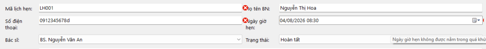
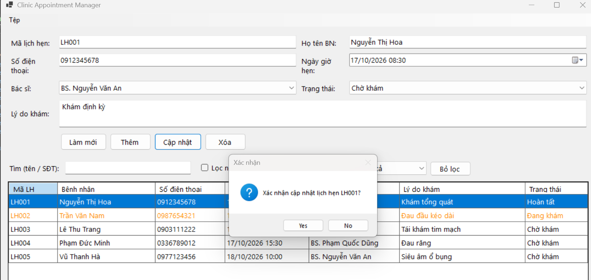
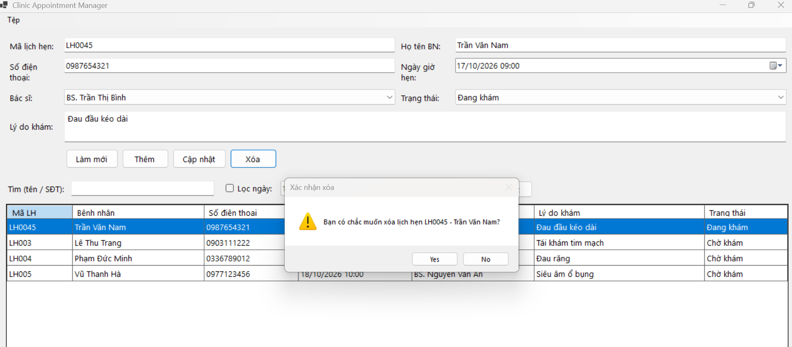
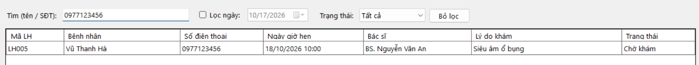
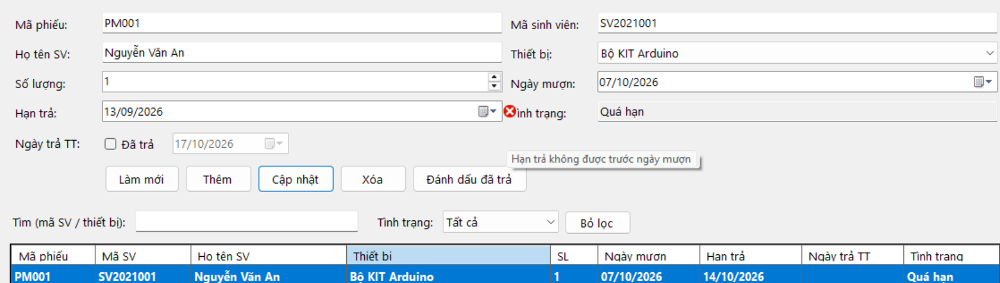
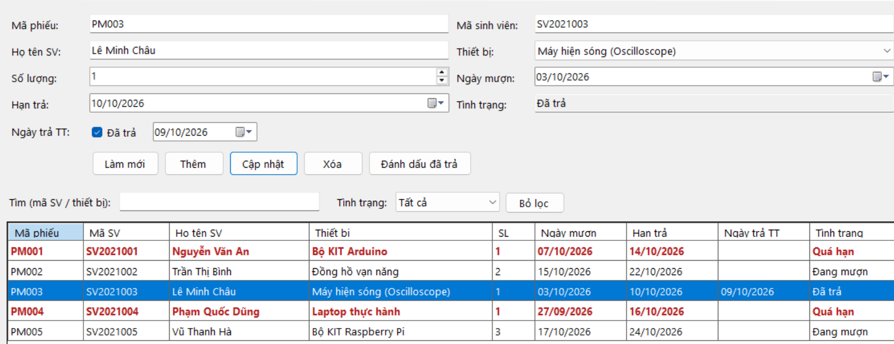
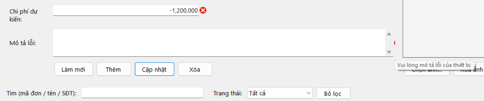
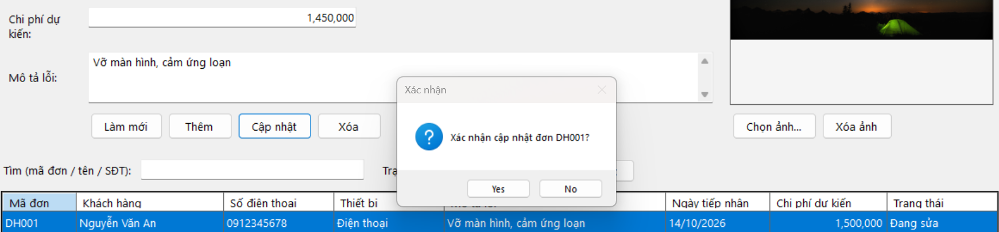
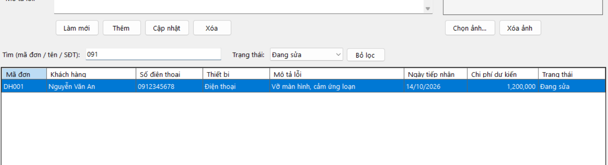
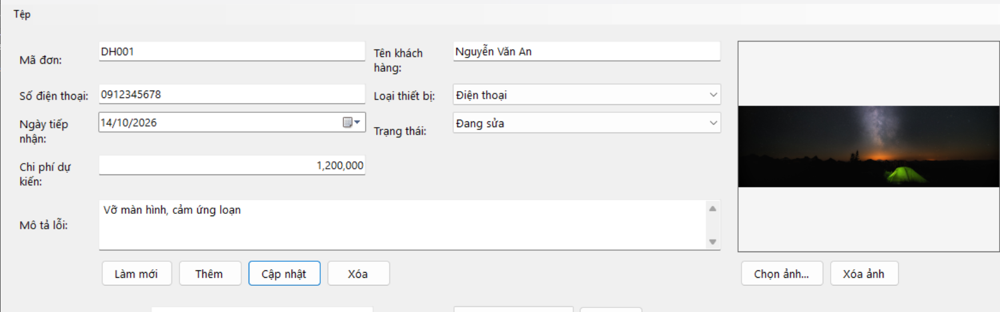

# BÁO CÁO BÀI TẬP NGÀY 17/10/26

## THÔNG TIN SINH VIÊN
- **Họ và tên:** Trần Thế Hào
- **Mã số sinh viên:** 24810320120
- **Lớp:** D19QTANM1
- **Tên môn học:** Lập trình C# / Windows Forms
- **Tên bài tập:** Bài 1-3

---

## DANH SÁCH BÀI TẬP

| Bài | Tên bài | Thư mục |
|---|---|---|
| 1 | Quản lý lịch hẹn phòng khám | [Bai1](./Bai1) |
| 2 | Quản lý mượn trả thiết bị tại phòng thực hành | [Bai2](./bai2) |
| 3 | Quản lý đơn đăng ký dịch vụ sửa chữa | [Bai3](./Bai3) |

---

## KẾT QUẢ THỰC HÀNH

### Bài 1 - Quản lý lịch hẹn phòng khám

### Bài 2 - Quản lý mượn trả thiết bị tại phòng thực hành

### Bài 3 - Quản lý đơn đăng ký dịch vụ sửa chữa

---
